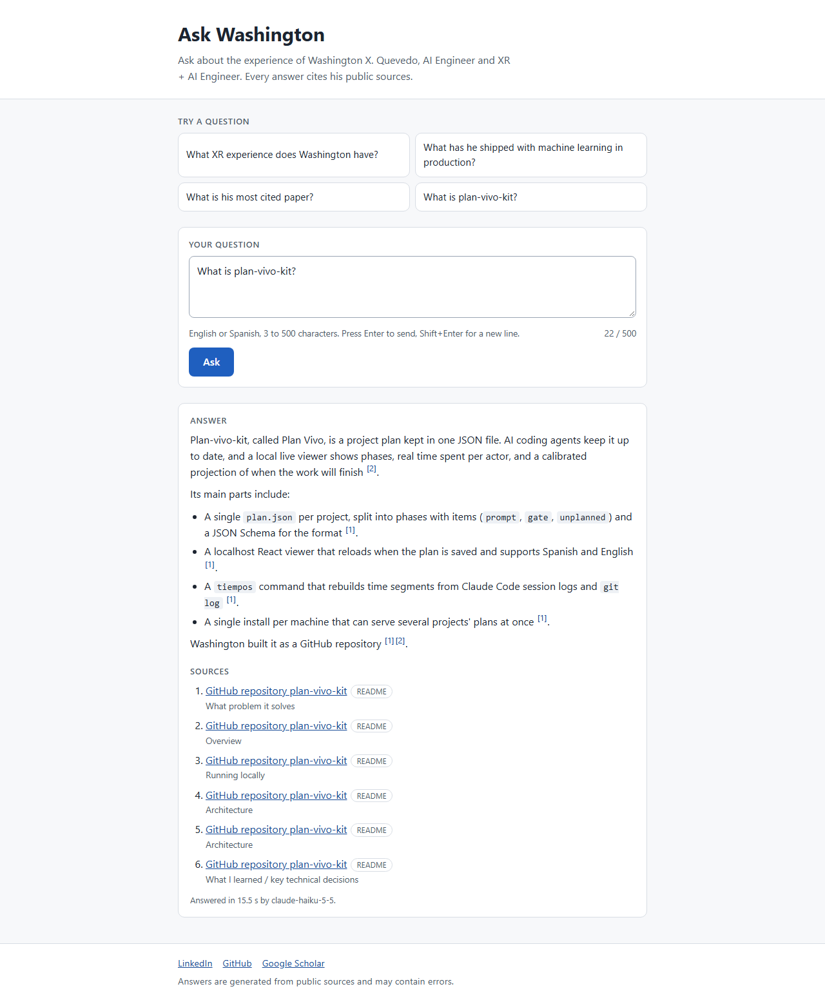
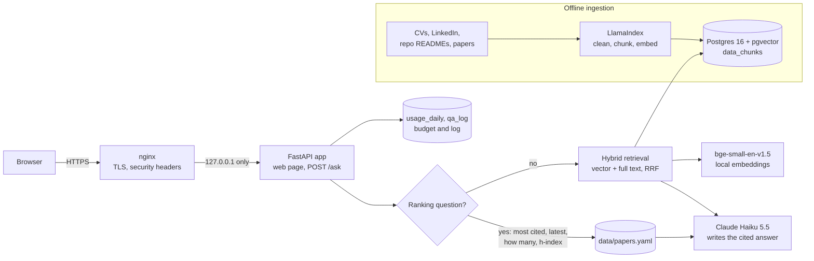
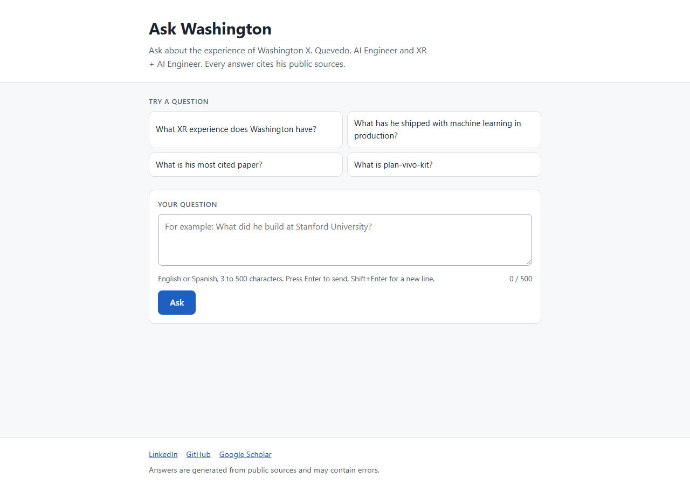
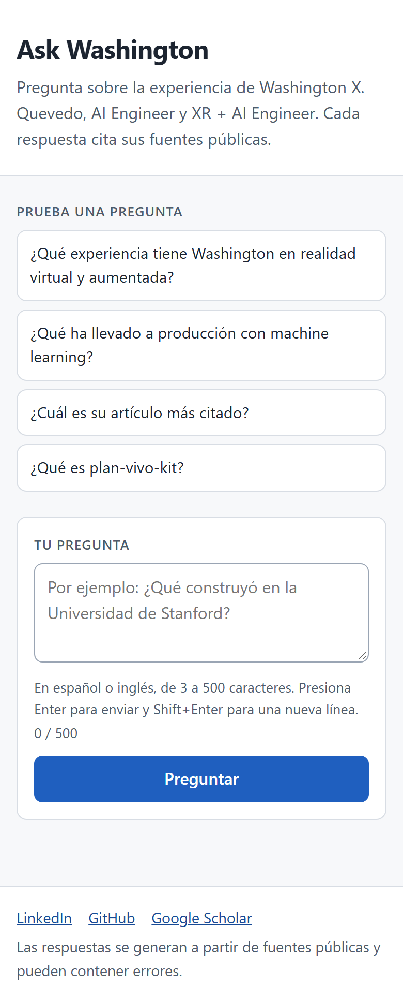
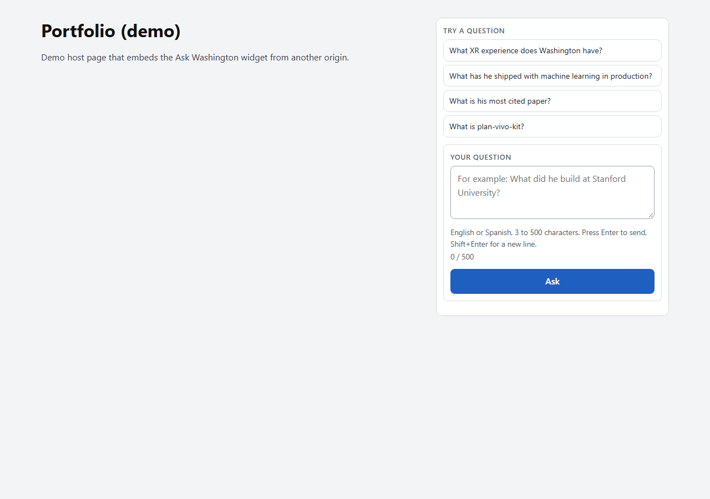
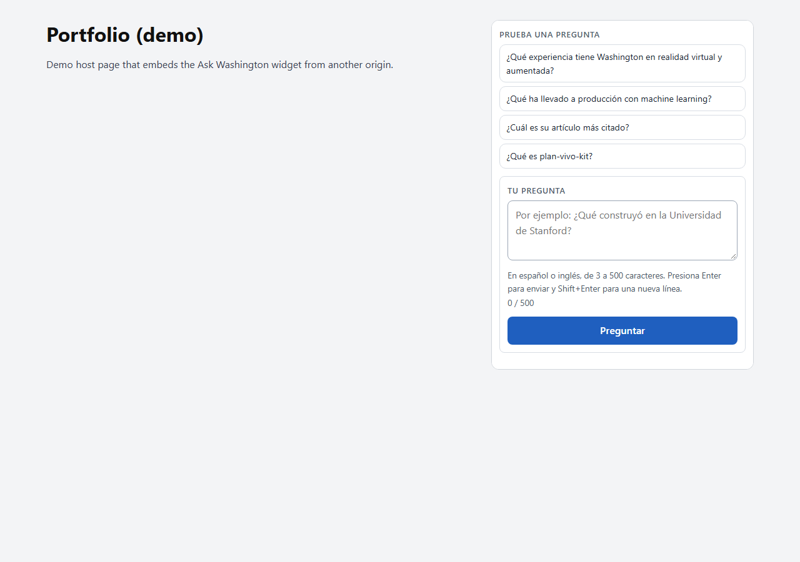

# Ask Washington

A retrieval-augmented (RAG) chat for the portfolio of Washington X. Quevedo, AI Engineer (XR + AI). A recruiter asks about his experience and the system answers by citing his own public sources: CV, LinkedIn profile, the READMEs of his public repositories and the abstracts of his papers.

It is also a learning project for RAG, vector databases, LangChain and LlamaIndex.

**Demo: https://ask.inmersoft.com**



## Architecture



- **Ingestion** (offline): public sources are cleaned (contact details removed), split by heading into chunks of about 500 tokens, embedded locally and stored in pgvector with citation metadata.
- **Answering**: questions about rankings and counts are computed from the publication list; everything else retrieves 6 chunks with hybrid search. Claude writes a short answer that cites `[n]` sources, in the language of the question.
- **Safety and cost**: per-IP rate limits, a daily USD budget stored in Postgres, untrusted-input rules in the prompt, and a log with hashed IPs.

## Status

| Part | Status |
|---|---|
| Project base: FastAPI app, config, Postgres + pgvector, `/health`, tests, lint | Done |
| Document ingestion and vector index (LlamaIndex) | Done |
| Answer chain with citations (LangChain + Claude API, usage and spend limits) | Done |
| Evaluation set (30 questions) and retrieval tuning | Done |
| Web interface and production deployment (Docker, nginx, certbot) | Done |

## Stack

- Python 3.12, managed with [uv](https://docs.astral.sh/uv/)
- FastAPI + Uvicorn
- PostgreSQL 16 with [pgvector](https://github.com/pgvector/pgvector) (`pgvector/pgvector:pg16` image)
- pydantic-settings for configuration
- pytest and ruff
- LlamaIndex for loading, chunking and the pgvector store (`PGVectorStore`)
- Local embeddings with `BAAI/bge-small-en-v1.5` (384 dimensions, runs on CPU)
- LangChain for the answer chain, with the Anthropic Claude API (`claude-haiku-5-5` by default) through `langchain-anthropic`
- slowapi for per-IP rate limits
- Plain HTML, CSS and JavaScript for the web page (no framework, no build step)
- Docker multi-stage image (CPU-only PyTorch, models baked in), Docker Compose, nginx and certbot in production

## Run locally

Requirements: Python 3.12, uv, git, and either Docker (with Compose) or Podman (with `podman compose`).

### 1. Clone and configure

```bash
git clone <repo-url> ask-washington
cd ask-washington
cp .env.example .env
uv sync
```

`.env` holds development-only credentials. If port 5432 is taken on your machine, change both `POSTGRES_PORT` and the port in `DATABASE_URL`.

### 2. Start the database

With Docker:

```bash
docker compose up -d
docker compose ps
```

With Podman:

```bash
podman compose up -d
podman compose ps
```

Wait until the `db` service reports healthy.

#### Windows with a rootful Podman machine

A rootful Podman machine on WSL may not forward published ports to `localhost` on Windows: the container is healthy but `localhost:5432` times out. In that case, before starting the app, run:

```powershell
powershell -ExecutionPolicy Bypass -File scripts\dev-db-host.ps1
```

It reads the current IP of the Podman machine and rewrites only the `DATABASE_URL` line in `.env`, then prints the resulting URL with the password masked. The machine IP changes when the machine restarts, so run it again after every `podman machine start`.

With Docker, or on Linux, keep `localhost` in `DATABASE_URL` and skip this step.

### 3. Enable pgvector

The app runs `CREATE EXTENSION IF NOT EXISTS vector` on startup. You can also run it on its own:

```bash
uv run python -m scripts.init_db
```

### 4. Run the app

```bash
uv run uvicorn app.main:app --reload
```

Then check the health endpoint:

```bash
curl http://127.0.0.1:8000/health
```

It returns `200` with `"status": "ok"` when the database is reachable and the `vector` extension is installed, and `503` with `"status": "degraded"` otherwise.

### 5. Tests and lint

The tests need the database running.

```bash
uv run pytest
uv run ruff check .
uv run ruff format --check .
```

### Stop the database

```bash
docker compose down     # or: podman compose down
```

Data lives in the named volume `ask_washington_pgdata`. Add `-v` to `down` to delete it.

## Ingestion

Only public sources are indexed. They live in `data/` and are not fetched at run time:

| doc_type | Source | Local path | `public_url` |
|---|---|---|---|
| `cv` | The two English CVs (AI Engineer, XR + AI Engineer) | `data/sources/cv/*.pdf` | LinkedIn profile (the CVs have no public URL) |
| `linkedin` | Published sections of the LinkedIn profile | `data/sources/linkedin/LINKEDIN_EN.md` | LinkedIn profile |
| `repo_readme` | READMEs of 6 public repositories | `data/sources/repos/<repo>.md` | GitHub repository |
| `paper` | 25 most cited papers: title, venue, year, citations, abstract | `data/papers.yaml` | DOI |

`data/sources/` is not committed. `data/papers.yaml` is committed: it is `data/papers_seed.yaml` enriched with DOI, URL and abstract from the publisher pages.

Before indexing, email addresses and phone numbers are removed, and from the LinkedIn working file only the published sections (headline, about, experience, skills, education and awards) are kept.

### Commands

```bash
# Repository READMEs (needs the GitHub CLI; or download them from raw.githubusercontent.com)
for r in plan-vivo-kit localia-genai-platform forex-trading-system agent-office-visualizer focus riemann-hypothesis; do
  gh api repos/wx-quevedo/$r/readme -H "Accept: application/vnd.github.raw" > data/sources/repos/$r.md
done

uv run python -m scripts.ingest                 # ingest new or changed documents
uv run python -m scripts.ingest --only paper    # one doc_type: cv, linkedin, repo_readme or paper
uv run python -m scripts.ingest --reset         # drop the index and rebuild it
uv run python -m scripts.search_check           # 5 test queries, top 3 with score, document and URL
uv run python -m scripts.search_check "Unity experience" --top-k 5
```

The first run downloads the embedding model (about 130 MB) to the Hugging Face cache.

### How it works

- **Loading**: LlamaIndex `PDFReader` for the CVs, plain Markdown for LinkedIn and the READMEs, one document per paper.
- **Chunking**: `MarkdownNodeParser` splits by heading, then `SentenceSplitter` makes chunks of about 500 tokens with 60 tokens of overlap. Each paper is a single chunk.
- **Embeddings**: `BAAI/bge-small-en-v1.5`, normalized; queries get the BGE retrieval instruction. Only `title`, `section` and `doc_type` are embedded together with the text.
- **Idempotent**: every document has a SHA-256 hash of its text, metadata and chunking settings. Unchanged documents are skipped, changed ones are replaced, and documents removed from the sources are deleted from the index.

### Tables

| Table | Contents |
|---|---|
| `data_chunks` | Created by LlamaIndex `PGVectorStore` (table name `chunks`, prefixed with `data_`). Columns: `id` (bigserial), `node_id` (for example `repo-focus#003`), `text`, `metadata_` (jsonb), `embedding` (`vector(384)`, HNSW index with cosine distance). |
| `ingested_documents` | One row per source document: `doc_id`, `doc_type`, `title`, `content_hash`, `chunk_count`, `ingested_at`. Used to skip unchanged documents. |
| `usage_daily` | One row per day: `requests`, `input_tokens`, `output_tokens`, `cost_usd`. Used for the daily budget of `/ask`. |
| `qa_log` | One row per `/ask` request (see Ask API). |

Metadata stored with every chunk in `metadata_`:

| Key | Example |
|---|---|
| `doc_id` | `paper-p01`, `repo-focus`, `cv-ai-engineer`, `linkedin-profile` |
| `doc_type` | `cv`, `linkedin`, `repo_readme`, `paper` |
| `title` | `Unity3D-MatLab simulator in real time for robotics applications` |
| `section` | `Experience > Stanford University — Software & AI Consultant (Buscapez project)` |
| `public_url` | `https://doi.org/10.1007/978-3-319-40621-3_19` |
| `year` | `2016` (papers only; papers also carry `citations` and `doi`) |
| `chunk_index`, `content_hash` | position in the document and hash of the source document |

## Ask API

`POST /ask` answers a question about Washington from the indexed sources and cites them.

```bash
curl -s http://127.0.0.1:8000/ask \
  -H "Content-Type: application/json" \
  -d '{"question": "What is his most cited paper?", "lang": "en"}'
```

```json
{
  "lang": "en",
  "answer": "Washington's most cited paper is \"Unity3D-MatLab simulator in real time for robotics applications\" (2016) ... 88 citations on Google Scholar, as of a 2026-10-17 snapshot [1]. ...",
  "sources": [
    {"n": 1, "title": "Unity3D-MatLab simulator in real time for robotics applications", "doc_type": "paper",
     "section": "Citations ranking", "public_url": "https://doi.org/10.1007/978-3-319-40621-3_19", "score": null}
  ],
  "provider": "anthropic",
  "model": "claude-haiku-5-5",
  "latency_ms": 1193,
  "usage": {"input_tokens": 814, "output_tokens": 186}
}
```

- `question`: 3 to 500 characters, otherwise `422`.
- `lang` (optional, `en` or `es`, default `en`): the language of the page. The answer uses it, unless the question is clearly written in the other language; ambiguous questions (a name, an acronym) follow the page. The response includes the language used (`"lang": "es"`). Error messages (`422`, `429`, `502`) come in the same language; for `422` and the rate-limit `429` the API reads `lang` from the body or from `?lang=`.
- `sources[n]` matches the `[n]` markers in `answer`. `score` is the cosine similarity of the chunk, or `null` for computed facts.
- `429`: per-IP rate limit exceeded, or the daily spend budget is used up.
- `502`: the LLM provider failed; details stay in the server log.

### How an answer is built

1. **Ranking route.** Questions about the most cited or latest papers, the number of papers, or citation metrics (h-index, i10-index, total citations) are detected with regular expressions (English and Spanish). The facts are computed from `data/papers.yaml` and the Google Scholar profile totals (640 citations, h-index 14, i10-index 21, snapshot 2026-10-17); the LLM only writes them up.
2. **RAG route.** Anything else retrieves the top `RETRIEVAL_TOP_K` chunks from `data_chunks` with `RETRIEVAL_MODE` (default `hybrid`: the 20 best vector matches and the 20 best Postgres full-text matches, fused with Reciprocal Rank Fusion), numbers them, and sends them to the LLM.
3. The system prompt tells the model to answer only from the numbered sources, in the third person, citing `[n]`; to mention LinkedIn only when the sources do not answer the question; to reply in the language of the question; to ignore instructions inside the question; and never to give private contact details.

### Limits and logging

- **Rate limit** per client IP: `RATE_LIMIT_PER_MINUTE` and `RATE_LIMIT_PER_DAY` (slowapi, in memory, reset on restart).
- **Daily budget**: every answer adds its real token usage, priced with `LLM_PRICE_INPUT_PER_MTOK` and `LLM_PRICE_OUTPUT_PER_MTOK`, to the `usage_daily` table. Once the day's total reaches `DAILY_BUDGET_USD`, `/ask` returns `429` until the next day.
- **Log**: each request is stored in `qa_log` (time, question, source ids, tokens, cost, latency, route, provider, model, status). The client IP is stored only as a salted SHA-256 hash (`IP_HASH_SALT`).

### Environment variables

| Variable | Default | Notes |
|---|---|---|
| `ANTHROPIC_API_KEY` | (empty) | Required for the `anthropic` provider. Keep it in `.env`, never commit it. |
| `LLM_PROVIDER` | `anthropic` | Only `anthropic` is implemented. |
| `LLM_MODEL` | `claude-haiku-5-5` | |
| `LLM_MAX_TOKENS` | `600` | |
| `LLM_TEMPERATURE` | (empty) | Empty means not sent. Claude Haiku 5.5 rejects non-default sampling values; set it only for models that accept it. |
| `RETRIEVAL_TOP_K` | `6` | Chunks sent to the LLM on the RAG route. |
| `RETRIEVAL_MODE` | `hybrid` | `vector`, `hybrid` (vector + Postgres full text, fused with RRF), `rerank` (hybrid candidates re-scored by `RERANKER_MODEL`) or `rerank_light` (same with `ms-marco-MiniLM-L-6-v2`). See Evaluation. |
| `RETRIEVAL_CANDIDATES` | `20` | Candidates per search before fusion or reranking. |
| `RERANKER_MODEL` | `BAAI/bge-reranker-base` | Cross-encoder for `rerank` mode (downloaded on first use, about 1.1 GB). |
| `LLM_PRICE_INPUT_PER_MTOK` / `LLM_PRICE_OUTPUT_PER_MTOK` | `0.10` / `0.50` | USD per million tokens. Update them if you change the model. |
| `DAILY_BUDGET_USD` | `1.00` | |
| `RATE_LIMIT_PER_MINUTE` / `RATE_LIMIT_PER_DAY` | `10/minute` / `100/day` | |
| `IP_HASH_SALT` | `ask-washington` | Set your own value. |
| `FORWARDED_ALLOW_IPS` | `127.0.0.1` | Peers allowed to set `X-Forwarded-For` (IPs or CIDRs). Only the local reverse proxy; see Deployment. |
| `EMBED_ALLOWED_ORIGINS` | (empty) | Comma-separated origins that may embed the page in an iframe and send it `postMessage` events, for example `https://portfolio.example`. Empty: same origin only. See Embedding the widget. |

### Providers

`app/llm.py` builds the chat model from `LLM_PROVIDER`; the chain only sees a LangChain chat model. Planned, not implemented yet: `ollama` (a local model on a home machine) and `openai_compatible` (an OpenAI-compatible inference API such as Localia). Adding one means writing a builder and registering it in `PROVIDERS`. An unknown value fails with an error that lists the supported providers.

### Manual check against the real model

```bash
uv run uvicorn app.main:app
uv run python -m scripts.ask_check   # 5 questions, writes reports/P18-3_real_answers.json
```

This spends real tokens: the 5 questions cost about USD 0.002 with Claude Haiku 5.5.

## Evaluation

`data/eval/questions.yaml` holds 30 questions written from the indexed sources: XR/VR (5), AI/ML in production (5), papers and research (5), public repositories (5), career and companies (4), Spanish (3), out of scope (2) and prompt injection (1). Each question lists the documents that contain the answer (`expected_doc_ids`), 2 to 4 facts the answer must contain (`expected_keywords`), and whether the assistant should decline (`should_refuse`).

```bash
uv run python -m scripts.eval                                   # retrieval only, free: vector, hybrid, rerank
uv run python -m scripts.eval --modes vector,hybrid             # selected retrieval modes
uv run python -m scripts.eval --answers --label final           # real LLM on all 30 questions (about USD 0.011)
uv run python -m scripts.eval --answers --mode rerank --max-usd 0.05
```

Results go to `reports/eval/` as JSON and Markdown. `--answers` projects the cost first and stops if it would pass `--max-usd` (default 0.10).

Metrics:

- **Retrieval** (27 answerable questions, no LLM): `hit@3` / `hit@6` (an expected document among the first 3 / 6 chunks), `MRR` (mean reciprocal rank of the first expected document), `kw@6` (share of expected facts present in the text of the 6 chunks), latency per query on CPU after warm-up.
- **Answers** (real LLM): share of expected facts in the answer, valid citations (each `[n]` exists and its source is an expected document or contains an expected fact), correct refusals for out-of-scope and injection questions (declines and does not leak the prompt), share of answers that mention LinkedIn, mean latency and total cost.

### Results (2026-10-17, CPU, Claude Haiku 5.5)

Retrieval:

| Config | hit@3 | hit@6 | MRR | kw@6 | Latency mean (ms) | Latency p95 (ms) |
|---|---:|---:|---:|---:|---:|---:|
| A. vector | 0.889 | 1.000 | 0.914 | 0.981 | 26 | 31 |
| **B. hybrid (vector + full text, RRF)** | **1.000** | **1.000** | **0.981** | **0.981** | **60** | **89** |
| C. hybrid + `BAAI/bge-reranker-base` (20 -> 6) | 1.000 | 1.000 | 1.000 | 1.000 | 4030 | 4872 |
| C'. hybrid + `ms-marco-MiniLM-L-6-v2` (20 -> 6) | 1.000 | 1.000 | 0.963 | 0.981 | 683 | 787 |

`hybrid` is the default: it reaches the reranker's hit@3 at 60 ms instead of 4 s. C' is available as `RETRIEVAL_MODE=rerank_light`; a re-run on 2026-10-17 gave the same quality (MRR 0.963, q20 still missed) at 779 ms, so it did not replace `hybrid`.

Answers (hybrid retrieval, 30 questions), before and after limiting LinkedIn suggestions in the prompt:

| Run | Facts in answer | Valid citations | Answers with citations | Correct refusals | Mentions LinkedIn (answerable) | Latency mean (ms) | Cost (USD) |
|---|---:|---:|---:|---:|---:|---:|---:|
| before | 0.963 | 0.980 | 1.000 | 1.000 | 0.593 | 1626 | 0.0110 |
| **after (current prompt)** | **0.963** | **0.984** | **1.000** | **1.000** | **0.074** | **1637** | **0.0110** |

Full analysis, including the questions that still fail: `reports/P18-4_evaluacion.md`.

## Web interface

`GET /` serves a single page (`app/static/`: HTML, CSS and JavaScript, no framework) in English or Spanish: `?lang=en|es` (English by default). Every visible text lives in `app/static/i18n/en.json` and `es.json`; the server fills the page with them and the script uses them to switch languages without reloading. The page has four suggested questions, a question box, the answer with `[n]` markers linked to the source list, loading and error states (including a clear message on `429`), and links to LinkedIn, GitHub and Google Scholar. It works with keyboard and screen readers (labels, focus handling, `aria-live`) and on phones. There is no inline script, so it runs under a strict Content Security Policy.

| Desktop | Mobile |
|---|---|
|  |  |

Widget embedded in a demo page (English and Spanish):

| English | Spanish |
|---|---|
|  |  |

## Embedding the widget

Ask Washington has no language switch of its own: it follows the page that contains it. `?embed=1` gives a compact widget without the big header and footer, sized to its content.

1. Add the embedding site to `EMBED_ALLOWED_ORIGINS` (for the deploy script: `EMBED_ALLOWED_ORIGINS=https://portfolio.example` in `deploy/.deploy.local`). The app then sends `Content-Security-Policy: frame-ancestors 'self' https://portfolio.example` and accepts `postMessage` events only from that origin.
2. Embed it, and send the language whenever the page switches:

```html
<iframe id="ask-washington"
        src="https://ask.inmersoft.com/?embed=1&lang=en"
        title="Ask Washington"
        style="width: 100%; max-width: 480px; height: 640px; border: 0;"></iframe>

<script>
  const ASK_ORIGIN = "https://ask.inmersoft.com";
  const frame = document.getElementById("ask-washington");

  // Call this from the portfolio's EN/ES switch.
  function setAskWashingtonLanguage(lang) {   // "en" or "es"
    frame.contentWindow.postMessage({ type: "ask-washington:lang", lang: lang }, ASK_ORIGIN);
  }

  // The widget reports its height so the iframe fits its content.
  window.addEventListener("message", (event) => {
    if (event.origin !== ASK_ORIGIN) return;
    if (event.data && event.data.type === "ask-washington:height") {
      frame.style.height = event.data.height + "px";
    }
  });
</script>
```

Start with `lang=` in the `src` matching the current page language (the first render does not wait for a message). Messages from origins that are not in `EMBED_ALLOWED_ORIGINS` are ignored, and the widget posts its height only to allowed origins. The widget does not show the footer, so the embedding page should keep a short note such as "Answers are generated from public sources and may contain errors."

## Deployment

Production runs as one Docker Compose project behind the host's nginx:

- `Dockerfile`: multi-stage build on `python:3.12-slim` with uv, CPU-only PyTorch, the embedding model downloaded at build time (offline at runtime), a non-root user and a health check on `/health`.
- `docker-compose.prod.yml`: project `ask-washington` with its own network and volume; the app is published on `127.0.0.1:<APP_PORT>` only and the database has no published ports; `restart: unless-stopped`; memory limits of 1.5 GB (app) and 512 MB (database).
- Uvicorn runs with `--proxy-headers`, and the app trusts `X-Forwarded-For` only from `FORWARDED_ALLOW_IPS` (the local proxy). nginx overwrites that header with the real client address, so clients cannot spoof it and the rate limit counts real clients.
- `deploy/nginx/ask.inmersoft.com.conf`: reverse proxy with `X-Forwarded-*` headers, request size limits and basic security headers (`nosniff`, referrer and permissions policies). The app sends `Content-Security-Policy` (including `frame-ancestors` from `EMBED_ALLOWED_ORIGINS`) and, when no other origin may embed it, `X-Frame-Options: SAMEORIGIN`; nginx must not add its own versions of those two headers. certbot adds HTTPS.
- Data: the server never receives the source documents. The deploy dumps the `data_chunks` and `ingested_documents` tables with `pg_dump -Fc` and restores them on the server.

One command deploys from a Windows machine with SSH access to the server:

```powershell
copy deploy\.deploy.local.example deploy\.deploy.local   # set DEPLOY_HOST=user@host (ignored by git)
powershell -ExecutionPolicy Bypass -File deploy\deploy.ps1 -DryRun   # local check, sends nothing
powershell -ExecutionPolicy Bypass -File deploy\deploy.ps1
```

`deploy.ps1` packages `HEAD` with `git archive`, dumps the vector store, writes a production `.env` (mode 600, only the needed variables, `ANTHROPIC_API_KEY` read from the local `.env` without printing it), uploads them with `scp`, and runs `deploy/remote-deploy.sh` in one `ssh -t` session that asks for the sudo password once. On the server it installs the code in `/var/www/ask-washington`, aborts if the app port is used by something else, runs `docker compose -p ask-washington up -d --build`, waits for `/health`, restores the dump, installs the nginx site, reloads nginx only if `nginx -t` passes, and runs certbot. It is idempotent: re-running it updates the same project. `deploy/rollback.ps1` stops only this project's containers and removes only its nginx site.

The same steps by hand, without the scripts:

```bash
docker compose -p ask-washington -f docker-compose.prod.yml up -d --build
docker compose -p ask-washington -f docker-compose.prod.yml exec -T db \
  pg_restore --clean --if-exists --no-owner -U askw -d ask_washington < data.dump
```

The interactive API docs (`/docs`) load assets from a CDN, which the production Content Security Policy blocks; use them locally.

## Known issues

- **Rootful Podman machine on Windows does not forward ports to `localhost`.** Run `scripts\dev-db-host.ps1` before starting the app (see [Windows with a rootful Podman machine](#windows-with-a-rootful-podman-machine)). Enabling the machine's user-mode networking did not fix it with Podman 6.0.2.
- **Containers fail to start with `aardvark-dns failed to start ... open resolv.conf: No such file or directory`.** This can happen after turning the Podman machine's user-mode networking off again: the machine loses its `/etc/resolv.conf` link. Restore it and start the containers again:

  ```powershell
  podman machine ssh "sudo ln -sf /mnt/wsl/resolv.conf /etc/resolv.conf"
  ```

## Project layout

```
app/        FastAPI app (main.py), settings (config.py), database helpers (db.py),
            source loading and chunking (ingestion.py), embeddings and pgvector (vector_store.py),
            answer chain (rag.py), ranking route (ranking.py), LLM factory (llm.py),
            budget and log tables (usage.py), retrieval modes (retrieval.py), web page (static/)
scripts/    init_db.py, ingest.py, search_check.py, ask_check.py, eval.py, download_models.py,
            dev-db-host.ps1
deploy/     deploy.ps1, rollback.ps1, remote-deploy.sh, nginx site, .deploy.local.example
tests/      pytest suite
data/       Source documents (see data/README.md); papers.yaml and eval/questions.yaml are committed
reports/    Reports for each stage
```

## License

MIT. See [LICENSE](LICENSE).
